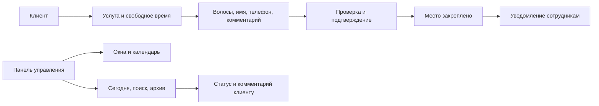

# 💎 Жемчужина — запись без ожидания

Telegram-бот для Академии красоты «Жемчужина» в Мариуполе. Клиент выбирает свободное время, заполняет короткую анкету и сразу получает подтверждение. Сотрудники управляют расписанием и записями в том же Telegram.

Проект начался с обычной переписки: «Какие окна есть?» → «На какое время?» → «Имя и телефон?» → ожидание ответа. Теперь эту последовательность проводит бот, а хозяйка занимается академией.

**[Открыть бота](https://t.me/MariupolPearlBookingBot)** · **[Канал академии](https://t.me/Mariupol_pearlacademj)**

## Один бот — две стороны записи



### Для клиента

- **Стрижка:** длина волос, имя, обязательный телефон и необязательный комментарий.
- **Окрашивание:** длина; «Окрашены волосы или нет?»; состояние волос; желаемый результат; необязательное фото; имя, телефон и комментарий.
- **Обучение:** интересующее направление и контакты для связи с академией.
- **Мои записи:** история, статус, комментарий академии и отмена действующей записи с подтверждением.

Место занимается только после нажатия «Подтвердить». Если два клиента выбирают последнее место одновременно, SQLite закрепляет его за одним из них; второй получает предложение выбрать другое время.

### Для сотрудников

| Задача | Как устроено |
| --- | --- |
| Создать окно | Услуга → время → дата в календаре → количество мест → проверка |
| Создать несколько окон | Выбрать даты, настроить время всем дням или каждому отдельно |
| Изменить окно | Показать, скрыть, изменить число мест или убрать из расписания |
| Посмотреть рабочий день | Кнопка «Записи на сегодня» прямо в панели |
| Найти клиента | По имени, телефону, номеру записи или дате; регистр русского текста не важен |
| Разобрать записи | Предстоящие, сегодняшние, все или архив; фильтр по статусу и сортировка |
| Сообщить решение | Новый статус и необязательный комментарий, который увидит клиент |
| Подготовить пост | Предпросмотр свободных окон и публикация в настроенный канал |
| Передать управление | Добавить сотрудника, назначить роль, передать владение |

Часы и число мест в массовом календаре выбираются кнопками. Для нестандартного времени можно отправить `10:30 2, 13:15 1`. Повторяющееся окно при массовом создании пропускается: его места и записи сохраняются. Режим диапазона и графика 2/2 сейчас скрыт, чтобы основной сценарий оставался простым.

## Роли и доступ

| Роль | Доступ |
| --- | --- |
| Владелец | Полное управление, назначение ролей и передача владения; вход по паролю |
| Администратор | Расписание и записи, просмотр сотрудников, управление менеджерами; вход по назначенной роли |
| Менеджер | Расписание, записи, статусы, заявки на обучение, просмотр ролей; вход по назначенной роли |

`/admin` открывает панель. Менеджерам и администраторам пароль вводить не нужно: бот проверяет их Telegram ID в таблице назначенных ролей при каждом действии. Удаление роли сразу прекращает доступ.

Если владельца ещё нет, первый успешный вход с `ADMIN_PASSWORD` назначает владельца. После этого пароль не позволяет постороннему назначить себя сотрудником. `OWNER_IDS` пригодится для предварительного назначения владельца; можно оставить пустым.

Сеанс владельца действует 12 часов. Пять неверных паролей блокируют вход на 15 минут; блокировка сохраняется после перезапуска. При передаче владения получатель становится владельцем, а отправитель — администратором. Изменение `OWNER_IDS` при последующих перезапусках не отменяет уже выполненную передачу.

## Чат, который можно начать заново

`/start` сбрасывает незавершённую анкету, отменяет её неотправленные экраны и создаёт новое главное меню. Это работает и после удаления переписки в Telegram. Основной экран обновляется редактированием, вспомогательные сообщения очищаются после успешного ответа. Фото, карточки и запросы контакта иногда требуют отдельных сообщений.

Очистка находится в **Главное меню → Ещё → Очистить сообщения**; также есть `/clean`. Она убирает до 200 последних сообщений, сохраняя меню, записи и заявки в базе. На удаление старых сообщений распространяются ограничения Telegram.

Прошедшие окна исчезают из выбора автоматически. Записи по ним сохраняются в архиве и доступны для изменения статуса. Ручное архивирование не отменяет запись и не освобождает её место: для этого нужно изменить статус.

## Быстрый запуск

Python **3.12**, зависимости зафиксированы в `requirements.txt` и `requirements-web.txt`.

```bash
python3.12 -m venv .venv
source .venv/bin/activate
pip install -r requirements.txt
cp .env.example .env
```

Заполните `.env`, затем запустите локальный polling:

```bash
python -m pearl
```

Не запускайте polling одновременно с webhook на хостинге. Для локального запуска бота, уже подключённого к хостингу, сначала отключите webhook или используйте отдельного тестового бота.

| Переменная | Назначение |
| --- | --- |
| `BOT_TOKEN` | Токен от BotFather |
| `ADMIN_PASSWORD` | Пароль владельца, минимум 12 символов |
| `OWNER_IDS` | Необязательный список Telegram ID владельцев через запятую |
| `CHANNEL_ID` | ID или username канала для публикации; можно оставить пустым |
| `DATABASE_PATH` | Путь к SQLite, по умолчанию `data/pearl.sqlite3` |
| `TIMEZONE` | Часовой пояс, по умолчанию `Europe/Moscow` |
| `SALON_ADDRESS`, `SALON_PHONE` | Адрес и телефон академии |
| `WEBHOOK_SECRET` | Секретный заголовок для webhook, минимум 24 символа |
| `WEBHOOK_BASE_URL` | HTTPS-адрес приложения для настройки webhook |
| `TELEGRAM_PROXY` | Необязательный прокси для исходящих запросов к Telegram |

`.env`, рабочая база, резервные копии и архивы развёртывания исключены из Git.

### Docker

```bash
docker compose up -d --build
```

Этот вариант запускает polling. Каталог `data` сохраняет базу между перезапусками.

### PythonAnywhere

Рабочий webhook запускается как Flask/WSGI-приложение. Пошаговая инструкция: **[deploy/PYTHONANYWHERE.md](deploy/PYTHONANYWHERE.md)**.

Бесплатный режим не требует постоянно открытой консоли. Его веб-приложение нужно продлевать в панели хостинга. Уведомления и обновления публикации отправляются при входящих событиях; самостоятельного фонового расписания на этом тарифе нет. Для выбора дат служебные уведомления откладываются до следующего обычного действия, чтобы не задерживать календарь.

Для публикации добавьте бота в канал администратором с правом публиковать и редактировать сообщения, задайте `CHANNEL_ID` и нажмите «Опубликовать / обновить пост». Бот редактирует свой пост с актуальными свободными окнами. Пустой `CHANNEL_ID` оставляет публикацию выключенной.

## Что защищает запись от сбоев

- Окна, роли, анкеты и история хранятся на постоянном диске в SQLite.
- Транзакция резервирования защищает последнее место и исключает повторную активную запись клиента на то же окно.
- Обработанные update ID сохраняются: повтор доставки webhook не оформляет заявку второй раз.
- Ответы интерфейса и уведомления проходят через очередь; после сетевой ошибки их можно отправить повторно без повторного шага анкеты.
- Неотправленные старые изменения календаря заменяются актуальным экраном.
- Webhook переиспользует маршрутизатор, цикл asyncio и HTTP-соединения; выбор даты требует одного исходящего запроса редактирования.
- Изменение статуса и комментарий для клиента сохраняются вместе с уведомлением в одной транзакции.
- Обновление схемы добавляет новые поля к существующей базе. Перед развёртыванием используйте SQLite backup API, чтобы сохранить согласованную копию.

Технически это **aiogram + SQLite + Flask**, без внешнего сервиса бронирования.

## Проверка

```bash
python -m unittest discover -s tests -q
```

Тесты проверяют конкурентную запись на последнее место, права ролей, передачу владения, сохранность старой базы при обновлении, сценарии клиента, комментарии, поиск, архив, пошаговое создание окон, календарь, повтор webhook и восстановление интерфейса после сетевого сбоя.

## Где что лежит

```text
pearl/
  bot.py              клиентские сценарии и главное меню
  slot_wizard.py      пошаговое создание и изменение окна
  calendar_ui.py      календарь и время отдельно по дням
  booking_manager.py  поиск, архив, статусы и комментарии
  access.py, staff.py  роли и управление сотрудниками
  db.py               транзакции, история и миграции SQLite
  interaction.py      постоянный экран и очередь ответов
  storage.py          сохранение незавершённых анкет
  web.py, transport.py webhook и соединения с Telegram
deploy/               инструкции и WSGI для PythonAnywhere
tests/                тесты поведения и восстановления
```

## Дальше

Напоминания перед визитом; простая настройка повторяющегося графика без длинных команд; отдельный фоновый обработчик уведомлений и публикаций для постоянного хостинга.

Бот не обещает неподтверждённые цены или длительность окрашивания. Заявка на обучение передаётся сотруднику, который уточняет программу и условия.
