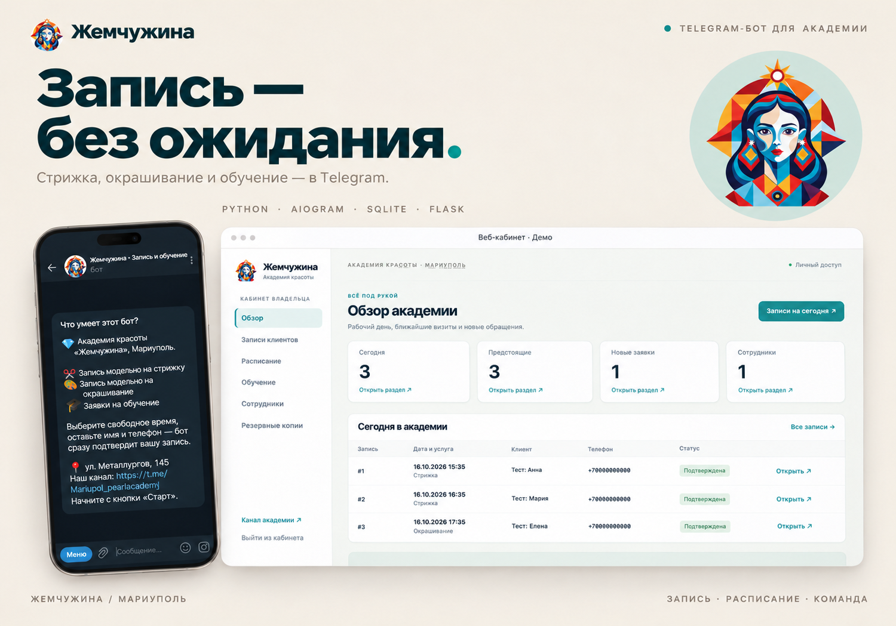
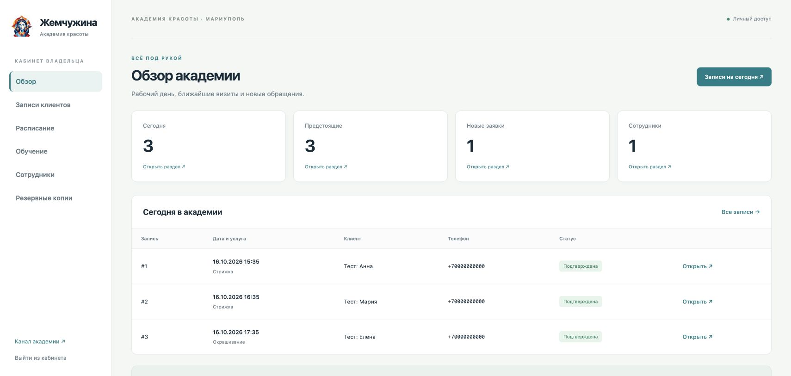
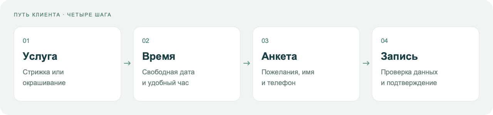
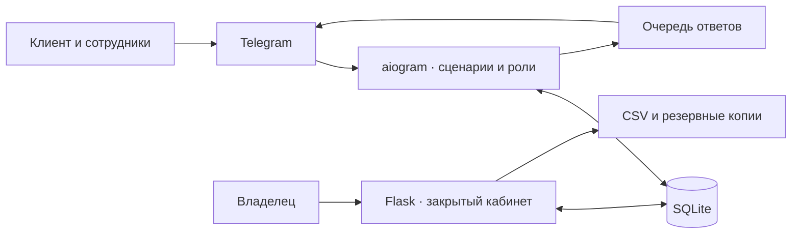

<div align="center">


# Жемчужина

### Запись в академию красоты — прямо в Telegram

Клиент выбирает время. Бот подтверждает запись. Команда видит свой рабочий день.


**[Открыть бота ↗](https://t.me/MariupolPearlBookingBot)** · **[Возможности](#возможности)** · **[Запуск](#быстрый-запуск)** · **[Документация](#документация)**

</div>



<sub>Презентационная обложка на основе интерфейсов проекта; данные кабинета — демонстрационные.</sub>

## Из переписки — в готовую запись

Проект для Академии красоты «Жемчужина» в Мариуполе. Идея появилась из реального сценария: чтобы записаться моделью на стрижку, приходилось узнавать свободные окна в личной переписке, ждать ответа и отдельно отправлять контакты.

Бот проводит клиента через выбор услуги, свободного времени и анкету. Расписание, записи и роли сотрудников хранятся в одной базе; владелец может просматривать их в закрытом веб-кабинете.

| Было в переписке | Стало в боте |
| --- | --- |
| Запросить свободные окна и дождаться ответа | Увидеть доступные даты и места |
| По очереди уточнять пожелания и контакты | Заполнить анкету под выбранную услугу |
| Попросить хозяйку подтвердить время | Получить подтверждение после бронирования места |
| Вручную сверять записи в сообщениях | Открыть сегодняшний день, поиск или архив |

## Интерфейс

### Рабочий день в одном кабинете

Обзор записей на сегодня, ближайшие визиты и заявки на обучение. Из бокового меню доступны расписание, сотрудники и резервные копии.



<sub>Скриншот работающего интерфейса на демонстрационной базе. Имена и номера телефонов — тестовые.</sub>

### Сценарий клиента



<sub>Схема сценария; не скриншот Telegram.</sub>

## Возможности

| Для клиента | Для команды академии |
| --- | --- |
| Стрижка и окрашивание с отдельными анкетами | Календарь с выбором нескольких дат |
| Длина, окрашенность и состояние волос, пожелания | Разное время и число мест для каждого дня |
| Имя, обязательный телефон и комментарий; фото для окрашивания | Создание, изменение и скрытие окон |
| Подтверждение без ожидания ответа сотрудника | Записи на сегодня, поиск, фильтры и сортировка |
| Статус и комментарий академии | Смена статуса и комментарий для клиента |
| Отмена своей записи с подтверждением | Архив и обработка заявок на обучение |
| Заявка на обучение с контактами | Предпросмотр и обновление поста со свободными окнами в настроенном канале |

**Веб-кабинет:** просмотр общих с ботом данных, карточки записей, поиск, архив, CSV и резервные копии. Изменения расписания и записей выполняются в Telegram.

**Три роли:** владелец, администратор и менеджер. Доступ сотрудников проверяется по Telegram ID. При передаче владения прежний владелец становится администратором. Веб-кабинет защищён отдельным паролем.

## Что продумано внутри

| Ситуация | Решение |
| --- | --- |
| Два клиента подтверждают последнее место | Транзакция SQLite закрепляет его за одним клиентом; второму предлагается другое время |
| Telegram повторно доставляет webhook | Обработанные update ID сохраняются, чтобы не повторять обработку |
| Сеть оборвалась при отправке ответа | Сохранённая очередь позволяет повторить отправку без повторного шага анкеты |
| Процесс перезапустился посреди анкеты | Состояние диалога хранится в SQLite |
| Клиент хочет начать заново | `/start` сбрасывает незавершённый сценарий и создаёт новое меню |
| Нужно убрать тестовые данные | Очистка создаёт резервную копию и сохраняет сотрудников и их роли |

Основной экран бота обновляется редактированием; вспомогательные сообщения очищаются по мере прохождения сценария. Для календаря устаревшие неотправленные экраны заменяются актуальным.

## Архитектура



**Python 3.12 · aiogram 3 · Flask 3 · SQLite · Gunicorn · Docker**

Для небольшого проекта используется одна база на постоянном диске. Подготовлены локальный polling, webhook для PythonAnywhere и Docker-вариант для хостинга с постоянным томом.

## Быстрый запуск

Из корня проекта:

```bash
python3.12 -m venv .venv
source .venv/bin/activate
pip install -r requirements.txt
cp .env.example .env
```

Заполните `BOT_TOKEN` и `ADMIN_PASSWORD` в `.env`, затем запустите бота:

```bash
python -m pearl
```

Используйте отдельного тестового бота или предварительно отключите webhook: polling и webhook одного бота одновременно не работают.

<details>
<summary><strong>Веб-кабинет и Docker</strong></summary>

Для веб-режима задайте `WEBHOOK_SECRET` и установите зависимости:

```bash
pip install -r requirements-deploy.txt
WEB_COOKIE_SECURE=0 gunicorn app:app --bind 127.0.0.1:8080 --workers 1 --threads 4 --timeout 90
```

Откройте `http://127.0.0.1:8080/admin/`. В отдельном терминале получите данные входа:

```bash
python scripts/manage_data.py web-access
```

Адрес и пароль сохранятся в приватном `data/web-access.txt`. `WEB_COOKIE_SECURE=0` нужен только для локального HTTP; на хостинге используйте HTTPS и значение `1`.

Для сервера с постоянным диском и HTTPS reverse proxy:

```bash
docker compose -f compose.web.yaml up -d --build
```

Настройка webhook и перенос описаны в [руководстве](docs/GUIDE.md) и [инструкции по хостингам](docs/HOSTING.md).

</details>

## Проверка поведения

```bash
python -m unittest discover -s tests -q
```

Тесты покрывают конкурентное бронирование, роли, передачу владения, анкеты, календарь, поиск и архив, повторную доставку webhook, сетевые сбои, защиту веб-кабинета, экспорт и восстановление данных.

## Документация

| Документ | Что внутри |
| --- | --- |
| [Полное руководство](docs/GUIDE.md) | Сценарии, роли, переменные окружения и структура проекта |
| [Данные и резервные копии](docs/DATA.md) | Хранение, доступ, очистка и восстановление |
| [Хостинг и перенос](docs/HOSTING.md) | Провайдеры и запуск на другом сервере |
| [PythonAnywhere](deploy/PYTHONANYWHERE.md) | Развёртывание webhook через WSGI |
| [Визуальный стиль](docs/BRANDING.md) | Исходный знак, адаптация логотипа и промпт генерации |

Рабочие базы, контакты клиентов, токены и пароли исключены из Git. Изображения README находятся в [`docs/assets`](docs/assets).

---

<div align="center">

**Жемчужина · Академия красоты, Мариуполь**

[Telegram-бот](https://t.me/MariupolPearlBookingBot) · [Канал академии](https://t.me/Mariupol_pearlacademj)

</div>
